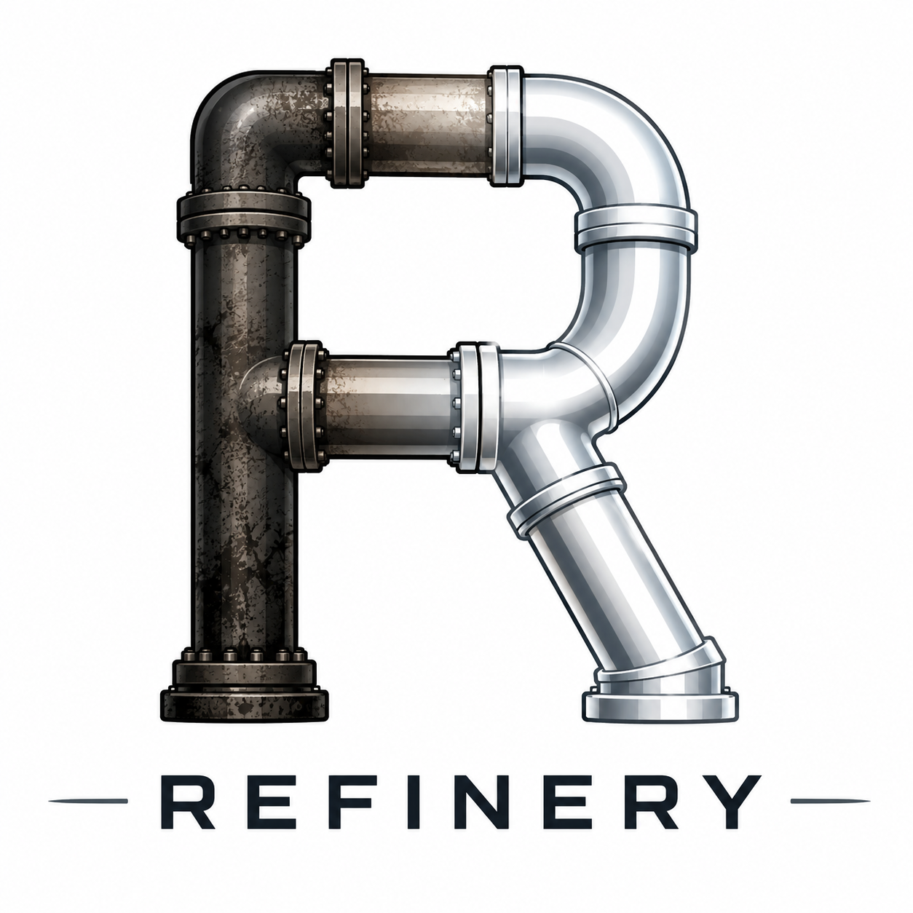

<p align="center">
  
</p>

# Refinery AI

Refinery AI is an early-stage, safe-by-default modernization factory for Java applications. It discovers a repository, builds a local context graph, creates a typed migration plan, routes deterministic work toward OpenRewrite, and verifies every approved step.

Version **0.1.0** is a runnable architectural foundation. Discovery, CodeGraph indexing, deterministic planning, safety gates, OpenRewrite dry runs, build verification, repair budgets, typed Pydantic AI agent boundaries, and run reports are implemented. Repository investigation now uses a read-only Pydantic AI Harness FileSystem/RepoContext pilot and safe assessment Shell profile behind the `RepositoryEnvironment` seam. Source-changing OpenRewrite and AI execution remain explicitly review-gated.

## Architecture

```text
                Modernization Factory
                         │
                   Discovery Loop
                         │
                  Knowledge Graph
                         │
                    Plan Loop
                         │
              ┌──────────┴──────────┐
              │                     │
       OpenRewrite            AI Migration
       deterministic             reasoning
              │                     │
              └──────────┬──────────┘
                         │
                  Verification Loop
                         │
                ┌────────┴────────┐
              GREEN             FAILURE
                │                   │
             next step         Repair Loop
                │                   │
                └───────────────────┘
```

The factory—not an unconstrained model—owns control flow, repository mutation, validation, and limits. Pydantic AI agents return validated Pydantic models at bounded reasoning points.

## What v0.1 does

- Detects Maven and Gradle repositories.
- Inspects modules, Java/test file counts, Maven dependencies, Java version, frameworks, Git branch, and worktree state.
- Builds a provider-neutral context graph from repository evidence.
- Uses CodeGraph as a context provider for code symbols and cross-file relationships.
- Adds Spring semantic context for beans, dependency injection, HTTP endpoints, configuration,
  persistence mappings, Kafka listeners, and cache usage.
- Adds infrastructure context from database drivers and SQL migrations, Kafka clients and
  configuration, and Redis templates, keyspaces, and connection configuration.
- Stores the normalized graph under `.refinery/context/context-graph.json` while retaining
  provider-native artifacts for diagnostics.
- Produces and validates an ordered `ModernizationPlan`.
- Provides typed Pydantic AI planning, migration, and repair agents.
- Runs allowlisted OpenRewrite recipes in dry-run mode.
- Selects Maven or Gradle verification commands without invoking a shell.
- Refuses apply-mode operation on a dirty worktree by default.
- Provides a read-only Harness FileSystem/RepoContext assessment factory.
- Runs explicitly approved argument vectors through a time/output-bounded Harness Shell pilot.
- Spills oversized tool output to durable external artifacts before context compaction.
- Delegates build/runtime investigation to one bounded read-only Harness specialist.
- Stops repeated failures and enforces repair-attempt budgets.
- Persists JSON and Markdown run records in `.refinery/runs/`.
- Logs commands, inspectors, context providers, and external service calls to stderr as they run.
- Produces versioned modernization assessments and uses a temporary local SonarQube Community
  Build by default for maintainability, risk, and coverage evidence.
- Resolves the effective Maven or Gradle runtime graph, normalizes Maven Package URLs, and checks
  OSV by default for dependency-health evidence.
- Stops at a review gate before applying OpenRewrite or AI-generated source changes.

## Requirements

- Python 3.12+
- [`uv`](https://docs.astral.sh/uv/)
- The [`codegraph`](https://github.com/colbymchenry/codegraph) CLI on `PATH`
- A JDK and Maven/Gradle, or the project wrappers, when running verification
- Installed bridge and target JDKs for profile runs; Refinery discovers them through `JAVA_HOME`,
  `PATH`, SDKMAN, and conventional macOS/Linux JDK locations
- Network access to configured artifact repositories and OSV for dependency analysis
- Docker when running the default SonarQube-backed assessment
- An AI provider API key only when using the Pydantic AI agents

## Setup

```bash
git clone git@github.com:YOUR-ORG/refinery-ai.git
cd refinery-ai
uv sync
uv run refinery version
```

Run all local quality checks:

```bash
make check
```

Or run them individually:

```bash
uv run ruff check .
uv run ruff format --check .
uv run mypy
uv run pytest
```

## Usage

Discover, assess, and summarize a Java repository in one pass:

```bash
uv run refinery analyze /path/to/java-project
```

Build and query its repository context graph:

```bash
uv run refinery graph \
  "Which services depend on the persistence layer?" \
  --repository /path/to/java-project
```

Emit JSON or write another copy of the summary:

```bash
uv run refinery analyze /path/to/java-project --json
uv run refinery analyze /path/to/java-project --output architecture-summary.md
```

The analyze command combines discovery, the context graph, bounded folder structure, and the
deterministic modernization assessment. It uses temporary local SonarQube and resolved dependency
analysis by default; pass `--no-sonarqube` and/or `--no-dependencies` to opt out. It persists both
`.refinery/assessment.md` and `.refinery/summary.md` (or JSON equivalents with `--json`) and keeps
immutable assessment history under `.refinery/assessments/`.

Assess modernization health. SonarQube is optional but enabled by default; Refinery starts a
loopback-only temporary container, imports its evidence, and removes it afterward:

```bash
uv run refinery analyze /path/to/java-project --name baseline
uv run refinery analyze /path/to/java-project --compare baseline
```

The rendered assessment output is retained as `.refinery/assessment.md` or
`.refinery/assessment.json`. Historical copies are stored alongside the immutable assessment data
as `.refinery/assessments/<assessment-id>.report.*`; comparison runs use `.comparison.*`.

Chat with the configured LLM using the retained Markdown reports and all read-only repository
evidence tools. Type `exit` or `quit` to end the session:

```bash
uv run refinery chat /path/to/java-project
```

The default provider is local Ollama with `gemma4:latest`; configure it with
`REFINERY_LITELLM_MODEL` and `REFINERY_LITELLM_API_BASE`.

Expose the same bounded, read-only evidence catalog to any MCP client over stdio:

```bash
uv run refinery mcp /path/to/java-project
```

Configure the client to launch that command. Each MCP tool includes a purpose description and,
where applicable, descriptions for its arguments so an LLM can choose and call it accurately.

For clients connecting over HTTP, launch the Streamable HTTP transport instead. It binds to
loopback by default and serves MCP at `http://127.0.0.1:8000/mcp`:

```bash
uv run refinery mcp /path/to/java-project --transport http
```

Use `--host` and `--port` to change the bind address. Binding to `0.0.0.0` exposes the server to
other machines reachable on the network and should only be done in a trusted environment.

The first run downloads the pinned SonarQube image if it is not already cached. If Docker or the
scan is unavailable, the lightweight assessment still completes and records the SonarQube
diagnostic. Disable all Docker activity explicitly with:

```bash
uv run refinery analyze /path/to/java-project --no-sonarqube
```

Dependency analysis is also optional but enabled by default. It asks Maven or Gradle for the
resolved runtime graph (including transitive versions), converts each component to a versioned
Maven Package URL, and queries the OSV batch API. A build-resolution or OSV failure is reported and
leaves Dependency Health unassessed. Disable it with:

```bash
uv run refinery analyze /path/to/java-project --no-dependencies
```

Human-readable assessment and summary reports show aggregate OSV counts only. Complete structured
findings are retained per run in `.refinery/dependencies/osv-findings-<assessment-id>.json`, and the
report prints the exact artifact path for later analysis.

OSV requests use the bundled `certifi` CA trust store. On a network that intercepts TLS with a
private certificate, configure that certificate in the trust chain when possible. As an explicit
temporary fallback, `--no-osv-verify-ssl` disables certificate verification for OSV requests and
records a warning in the assessment.

Planning and run commands automatically rebuild the context graph. CodeGraph produces its local
SQLite index and the builder exports that index into Refinery's normalized artifact:

```text
.codegraph/
└── codegraph.db
.refinery/context/
└── context-graph.json
```

Refinery reads the CodeGraph database in read-only mode and retains file, line, relationship,
metadata, and provenance fields in the normalized context graph.

Run the catalog-aware planner, persist its audit report, and print its recipe recommendations:

```bash
uv run refinery plan \
  /path/to/java-project \
  --goal "Upgrade this application to Java 17" \
  --target-java 17
```

Use a named modernization profile to keep recommendations within a defined target. Profiles live
under `src/refinery_ai/profiles/`; the initial profile permits prerequisite migrations while
excluding upgrades beyond Java 17, Spring Boot 3.2, and Springdoc 2.5:

```bash
uv run refinery plan /path/to/java-project \
  --profile spring-boot-3.2-java-17

uv run refinery migrate /path/to/java-project \
  --profile spring-boot-3.2-java-17 \
  --apply
```

The selected profile is stored with the plan. Supplying a different profile to `migrate` is
rejected, which prevents accidentally executing a plan against a different modernization target.
For now, reaching a profile's target may require more than one plan/migrate cycle.

To let Refinery repeat analyze, plan, and migrate until the profile has no remaining
recommendations, use the profile-driven run mode:

```bash
uv run refinery run \
  --repository /path/to/java-project \
  --profile spring-boot-3.2-java-17 \
  --apply
```

Profile runs are bounded to 20 cycles by default; use `--max-cycles` to choose another safety
limit. SonarQube runs on the first cycle and again only when Maven or Gradle dependency inputs
change. Otherwise, the last SonarQube result is retained in the new assessment. A failed migration,
a repeated plan, or a migration that produces no published change stops the loop for review.

Refinery selects a JDK independently for each command without changing the user's shell. Baseline
verification starts with the first planned Java target, then works backward to the declared source
JDK until the unchanged project builds. That verified JDK runs the early migrations; after each
Java upgrade, verification and subsequent migrations switch to the new target JDK. SDKMAN
installations are discovered beneath
`$SDKMAN_DIR/candidates/java` (or `~/.sdkman/candidates/java`). If a required major version is not
installed, the profile run stops with an actionable error.

To run only corpus projects whose IDs have never appeared in an earlier run summary:

```bash
uv run refinery run-corpus \
  evals/corpora/refinery-java8-spring-boot-test-corpus.yaml \
  --only-new \
  --no-ai-patching \
  --jobs 3
```

By default, history is read from `.refinery/corpus-runs` and projects marked as requiring test
configuration remain skipped. Use `--run-history /path/to/corpus-runs` for another history location,
or `--include-test-configuration-needed` to include those projects.
Use `--jobs` to run isolated projects concurrently; it defaults to `1`. Start with `2` or `3`
because Maven/Gradle processes still share CPU, memory, disk, and dependency caches.

To run the known-good regression set after changing prompts or migration architecture, select only
projects marked `baseline_test: true` in the corpus:

```bash
uv run refinery run-corpus \
  evals/corpora/refinery-java8-spring-boot-test-corpus.yaml \
  --baseline-tests-only \
  --jobs 3
```

The shorter alias `--baseline-only` is also accepted. Other filters, such as `--project`, `--tier`,
and `--no-ai-patching`, can be combined with this selection.

The earlier goal-first form remains supported with `--repository /path/to/java-project`.

The catalog connection verifies TLS using the bundled CA roots. In a development environment
with TLS interception, verification can be explicitly disabled for this request with
`--no-catalog-verify-ssl` (or `REFINERY_RECIPE_CATALOG_VERIFY_SSL=false`). The command prints a
warning whenever this protection is disabled.

Planner recipe definitions are loaded from the declarative YAML catalogs in both
`openrewrite/rewrite-migrate-java` and `openrewrite/rewrite-spring`. Each definition retains its
source repository and file path. The normalized catalogs are cached beneath
`.refinery/cache/recipe-sources/`; subsequent plans read that cache without contacting GitHub.
Use `--refresh-recipe-catalog` to explicitly download fresh definitions.

The full catalog is not placed in the planner prompt. The planner receives bounded tools to list
recipe categories, search compact recipe summaries, and inspect one exact recipe definition. A
recommendation is accepted only if that recipe was returned by a catalog tool during the current
planning run.

OpenAI-backed planners use the Responses API so GPT-5.6 models can combine configured reasoning
effort with these function tools. Ollama continues to use its OpenAI-compatible Chat Completions
endpoint.

The planner also writes a migration-agent handoff to `.refinery/plans/<run-id>.json`. Run the
latest persisted plan as an OpenRewrite preview, or explicitly apply it:

```bash
uv run refinery migrate /path/to/java-project
uv run refinery migrate /path/to/java-project --plan-id <run-id> --apply
```

Migration implementations live under `refinery_ai/migrations`; the dispatcher selects one from
each step's `execution_type`. OpenRewrite is the only registered type for now. In apply mode,
Refinery first records a build of the unchanged repository. A failing baseline stops the run
before any recipe executes and is reported separately from migration regressions. With a green
baseline, recipes run serially and each is followed by the repository's build verification command. The
plan stops at the first failing build so the responsible recipe is unambiguous.
The terminal shows concise per-step progress; full commands and captured output are retained in
`.refinery/logs/`. Pass `--json` to `migrate` when the complete result is needed on stdout.

Apply mode requires a clean Git checkout and creates one isolated worktree per migration under
`.refinery/worktrees/<run-id>/`. Each green step is checkpointed and the next worktree starts from
that exact revision. If a step fails, Refinery saves its patch, execution log, build log, and
summary under `.refinery/migration-runs/<run-id>/step-NNN/`, then removes only the failed
worktree. Earlier verified worktrees remain available, and the original checkout stays untouched
during recipe execution.

After execution, apply mode fast-forwards the source checkout to the last verified checkpoint by
default. Thus, successful recipes are applied even when a later recipe fails and is rolled back.
Use `--no-apply-result` to leave all verified changes isolated in their worktrees instead.

Semantic repair is disabled by default. `--repair-mode local` permits a bounded repair only when
an OpenRewrite migration leaves recognized Springfox source behind and verification fails. Local
mode requires `REFINERY_LITELLM_API_BASE` to point to `localhost`, `127.0.0.1`, or `::1`; only the
residual Java files, relevant `pom.xml` content, recipe name, and build failure are sent to that
endpoint. `--repair-mode configured-provider` uses the configured LiteLLM provider explicitly.
Every proposed patch is file-scoped, checked by Git, and must pass the build before checkpointing.

Subsequent planning runs read the retained failed-step records as repository-specific evidence.
Previously failed recipes are shown to the planner and excluded from the next persisted plan, so
planning can continue with the remaining useful migrations instead of repeating a known failure.
Maintained sequencing constraints live as Open Knowledge Format concepts under
`src/refinery_ai/refinery-context/` and are supplied to every AI planning run. Each rule document
is Markdown with YAML front matter; add generally applicable lessons there as migration behavior
is discovered. An OKF `index.md` can be added later if the bundle grows enough to benefit from
progressive disclosure.

Run approved commands. In v0.1 this establishes a build baseline, performs an OpenRewrite dry run, and then stops for review:

```bash
uv run refinery run \
  "Upgrade this application to Java 17" \
  --repository /path/to/java-project \
  --target-java 17 \
  --apply
```

Without `--apply`, `run` is non-mutating and behaves like `plan`.

## Configuration

Settings use the `REFINERY_` prefix and may be placed in `.env`. See `.env.example`.

| Setting | Default | Purpose |
|---|---:|---|
| `OPENAI_API_KEY` | none | OpenAI API key loaded from the environment or `.env` |
| `REFINERY_MODEL` | `openai:gpt-5.6-terra` | Pydantic AI planner model identifier |
| `REFINERY_LITELLM_MODEL` | `openai/gpt-5.6-terra` | LiteLLM provider and model identifier |
| `REFINERY_LITELLM_API_BASE` | none | Optional provider base URL; set to `http://localhost:11434` for Ollama |
| `REFINERY_OTEL_ENABLED` | `false` | Export Pydantic AI and LiteLLM telemetry over OTLP/HTTP |
| `REFINERY_OTEL_SERVICE_NAME` | `refinery-ai` | OpenTelemetry service name |
| `REFINERY_OTEL_ENDPOINT` | `http://localhost:4318` | OTLP/HTTP base endpoint; signal paths are added automatically |
| `REFINERY_OTEL_HEADERS` | none | Comma-separated, URL-encoded OTLP headers such as `Authorization=Basic%20...` |
| `REFINERY_OTEL_INCLUDE_CONTENT` | `false` | Include prompts, responses, tool arguments, and binary content in spans |
| `REFINERY_MAX_REPAIR_ATTEMPTS` | `3` | Repair-loop attempt limit |
| `REFINERY_REPAIR_MODE` | `disabled` | Semantic repair policy: `disabled`, `local`, or `configured-provider` |
| `REFINERY_COMMAND_TIMEOUT_SECONDS` | `900` | Build command timeout |
| `REFINERY_CODEGRAPH_TIMEOUT_SECONDS` | `900` | CodeGraph indexing timeout |
| `REFINERY_ALLOW_DIRTY_WORKTREE` | `false` | Permit apply mode with existing changes |
| `REFINERY_DEPENDENCY_ANALYSIS_ENABLED` | `true` | Resolve dependencies and query OSV |
| `REFINERY_DEPENDENCY_RESOLUTION_TIMEOUT_SECONDS` | `900` | Maven/Gradle graph timeout |
| `REFINERY_MAVEN_DEPENDENCY_PLUGIN_VERSION` | `3.11.0` | Pinned dependency-tree plugin |
| `REFINERY_OSV_API_URL` | `https://api.osv.dev` | OSV service base URL |
| `REFINERY_OSV_TIMEOUT_SECONDS` | `30` | Timeout for each OSV request |
| `REFINERY_OSV_VERIFY_SSL` | `true` | Verify OSV TLS certificates using the bundled CA store |
| `REFINERY_SONARQUBE_ENABLED` | `true` | Attempt temporary local SonarQube analysis |
| `REFINERY_SONARQUBE_IMAGE` | `sonarqube:26.8.0.126808-community` | Pinned Community Build image |
| `REFINERY_SONARQUBE_IMAGE_PULL_TIMEOUT_SECONDS` | `1800` | Initial image-download timeout |
| `REFINERY_SONARQUBE_STARTUP_TIMEOUT_SECONDS` | `180` | Temporary server startup timeout |
| `REFINERY_SONARQUBE_ANALYSIS_TIMEOUT_SECONDS` | `900` | Scanner and compute-task timeout |
| `REFINERY_SONARQUBE_GRADLE_SCANNER_VERSION` | `7.2.2.6593` | Pinned temporary Gradle scanner plugin |

### LLM telemetry

Telemetry is disabled by default. Enable it by pointing Refinery at any OTLP/HTTP receiver:

```dotenv
REFINERY_OTEL_ENABLED=true
REFINERY_OTEL_ENDPOINT=http://localhost:4318
REFINERY_OTEL_SERVICE_NAME=refinery-ai
```

Pydantic AI and direct LiteLLM calls share the same OpenTelemetry trace and meter providers.
They emit model request spans, latency, errors, token-usage metrics, and cost data when the model
provider supplies it. Prompt and response content is excluded by default; set
`REFINERY_OTEL_INCLUDE_CONTENT=true` only when the destination and data-retention policy are
appropriate for repository content.

Refinery also emits `refinery.llm.tokens` and `refinery.llm.requests` with workflow dimensions
for `refinery.phase`, `refinery.run.id`, `refinery.plan.id`, and, during AI repair,
`refinery.repair.attempt`. The bundled
[`docs/grafana/refinery-llm-dashboard.json`](docs/grafana/refinery-llm-dashboard.json) dashboard
uses these dimensions to separate planning from repair usage and show repair attempts.

For a hosted OTLP endpoint such as Langfuse, also set `REFINERY_OTEL_HEADERS` to the
URL-encoded authorization header supplied by that service. Code using Refinery as a library can
enable the same integration explicitly with `configure_telemetry(Settings())` before running an
agent or calling `run_tool_loop`.

## LiteLLM tool loop

`run_tool_loop` accepts `{role, prompt}` messages and typed Python functions. It derives
JSON schemas from function signatures, executes requested calls, appends their results,
and continues until the model answers or the turn limit is reached.

```python
from refinery_ai.llm import run_tool_loop

def find_service(name: str) -> dict[str, str]:
    """Find a service by name."""
    return {"name": name, "owner": "platform"}

result = run_tool_loop(
    [{"role": "user", "prompt": "Who owns the billing service?"}],
    tools=[find_service],
    max_turns=4,
)
print(result.content)
```

Persisted inspector results and the normalized context graph can be exposed as semantic,
bounded, read-only tools. Evidence collection remains outside the model-controlled loop.

```python
from pathlib import Path

from refinery_ai.llm import run_tool_loop
from refinery_ai.tools import RepositoryEvidenceTools

evidence = RepositoryEvidenceTools(Path("/path/to/java-project"))
result = run_tool_loop(
    [{"role": "user", "prompt": "Trace the Order API to its dependencies and risks."}],
    tools=evidence.tools(),
    max_turns=8,
)
print(result.content)
```

The catalog includes repository overview, symbol inventory, symbol search and explanation,
callers, callees, dependencies, dependents, finding search, and bounded inspector results.
Missing assessments, graphs, or call-level evidence produce explicit coverage information so
the model does not confuse absent evidence with proof that a relationship does not exist.

## Package layout

```text
src/refinery_ai/
├── agents.py        # typed Pydantic AI agents
├── cli.py           # CLI boundary
├── config.py        # environment configuration
├── context.py       # typed durable context receipts and artifacts
├── context_graph/   # graph core and all built-in evidence providers
├── discovery.py     # deterministic Maven/Gradle inspection
├── factory.py       # workflow and safety gates
├── harness.py       # read-only Harness pilot and safe Shell policy
├── inspectors/       # reusable evidence runner and integrations including OSV and SonarQube
├── models.py        # shared Pydantic contracts
├── openrewrite.py   # allowlisted dry-run adapter
├── planning.py      # deterministic planner and validation
├── repair.py        # repair-loop budgets
├── reporting.py     # JSON/Markdown audit output
├── repository.py    # Refinery-owned repository environment seam
├── specialists.py   # typed specialist output and deterministic merge
├── tools/           # bounded read-only LLM evidence tools
└── verification.py  # bounded build execution
```

## Safety model

Refinery AI separates facts, decisions, and effects:

1. Deterministic discovery records observed facts.
2. Context providers collect facts with source provenance; CodeGraph supplies structural facts.
3. The context builder deterministically merges provider fragments into a versioned graph.
4. Planning produces typed proposals; the agent boundary accepts scoped repository context.
5. Policy code validates plans before execution.
6. Only the factory may run commands or apply changes.
7. Every step defines acceptance checks.
8. OpenRewrite recipes are allowlisted and initially run in dry-run mode.
9. Generated patches are proposals; v0.1 never applies them automatically.
10. Failures stop the run, and repair attempts have hard budgets.

Subprocesses receive argument lists directly and are never invoked through a shell. Stored command output is bounded.

## Current limitations

- Lightweight Gradle discovery does not parse dependencies or Java toolchains; the assessment's
  optional resolved-dependency inspector obtains the effective dependency graph from Gradle itself.
- SonarQube Gradle analysis injects a pinned scanner plugin through a temporary init script when
  the project does not configure `org.sonarqube`; Refinery does not edit target build files.
- CodeGraph is run locally and exported from its SQLite index. Semantic providers also perform deterministic
  source and configuration analysis; deeper Java type resolution, runtime topology, dynamically
  constructed SQL, topics, and Redis keys are not yet inferred.
- OpenRewrite dry runs require the plugin/recipe dependencies to be resolvable by the target build.
- OpenRewrite source application is review-gated.
- AI agents are available as typed boundaries but are not invoked by the default CLI workflow.
- Harness is the sole built-in assessment environment and is used for repository investigation, context controls, and one build/runtime specialist. CodeGraph and OpenRewrite remain Refinery-owned domain tools behind that environment; the architect/planner, persistence, and other specialists remain unchanged.
- Harness Shell command checks are policy guardrails, not OS-level network isolation. Assessment configuration denies network authority, and no network-capable command is exposed, but hard egress isolation requires a future sandbox/container execution environment.
- Proposed AI patches are not automatically applied.
- No web service, UI, pull-request automation, or remote-repository cloning.

## Roadmap

The next milestone will feed scoped CodeGraph queries into the executable planning and repair agents, then add fixture-based real-build integration tests.

## License

Apache-2.0
