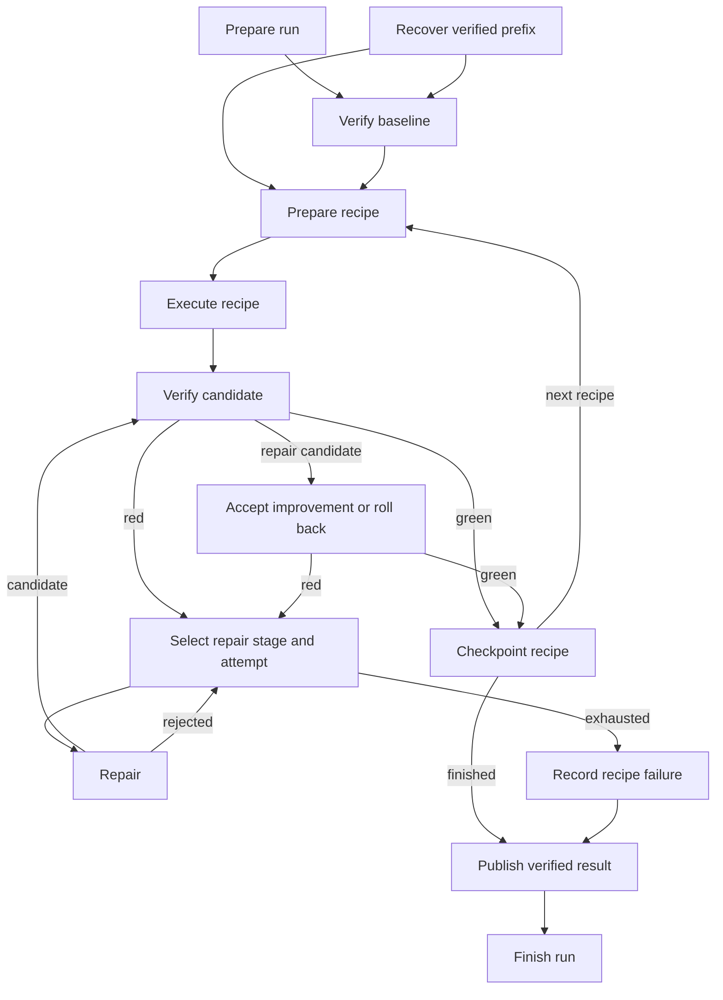

# Migration execution and recovery

Refinery executes persisted migration plans through a LangGraph workflow. The
public `MigrationRunner` remains the entry point for standalone migrations and
profile cycles. Recipe implementations, builds, repair agents and Git worktree
management remain injectable services; the graph owns sequencing and routing.



Preview execution skips baseline verification, candidate verification, repair,
Git checkpoints and publication. Apply execution uses isolated worktrees and
preserves deterministic-first repair budgets and JDK selection. Each repair
attempt is an individual graph visit. Long plans have a derived recursion budget.

## Structured events

Apply runs persist an append-only journal at:

```
.refinery/migration-events/<run-id>.jsonl
```

Use the configured state directory in place of `.refinery` when applicable.
The run ID is returned in `MigrationRun`/`migrate --json`, appears in events, and
names the directory under `.refinery/migration-runs/`. Event version 1 includes
run/plan/profile identity, ordered sequence numbers, UTC timestamps, phase,
lifecycle, node execution ID, recovery generation, optional recipe/attempt/JDK,
duration, outcome and checkpoint revision. A completed verification operation
can have outcome `verification_failed`; that is normal routing into repair,
not an unexpected exception.

Lifecycle values are `started`, `completed`, `failed`, `cancelled`, and
`interrupted`. A crash can leave an unmatched start; recovery records it as
interrupted. Source contents, prompts, credentials, full build diagnostics, and
raw model responses are not included. Existing artifacts retain detailed
build output. Each baseline JDK attempt has its own `baseline_build` events.

An in-process observer can consume typed events:

```python
from pathlib import Path
from refinery_ai.migrations.runner import MigrationRunner
from refinery_ai.planning_artifacts import MigrationPlanStore

runner = MigrationRunner(
    MigrationPlanStore(Path('/path/to/project')),
    event_observer=lambda event: print(event.phase, event.lifecycle, event.outcome),
)
result = runner.run(apply=True)
```

`read_migration_events(path)` in `refinery_ai.migrations.events` validates the
journal. An incomplete trailing record is tolerated; malformed complete records
and unsupported versions are errors. Recovery continues sequence numbers.
Observer exceptions are isolated. Journal write failures stop further execution
and still unwind pending transactional repairs. A journal is reporting history,
not authority to repeat a Git mutation.

When invoked within a parent LangGraph node, typed envelopes also reach its
custom stream. Consume the parent with `stream_mode=['custom', 'tasks']` and
`subgraphs=True` to combine those envelopes with native graph lifecycle output.
`build_migration_graph` exposes the child nodes/edges for inspection; runtime
services live in its invocation context rather than in serialized graph state.
No terminal/browser viewer, heartbeat display, or pi tool-event integration is
included yet. Existing OpenTelemetry/LangSmith instrumentation remains optional.

## Resume an interrupted apply run

```bash
uv run refinery migrate /path/to/project --resume-run <run-id>
```

Resume implies apply. It uses the original pinned plan and publication policy,
even if a newer plan exists. Omitted settings inherit recorded policy; explicit
conflicting CLI, environment or `.env` settings are rejected. Provider credentials
are supplied afresh and are never saved in the manifest. Pi's externally configured
default model can change independently; restarting a recipe makes fresh model calls
and does not continue an old pi session.

Recovery retains the longest contiguous verified recipe prefix. It discards the
interrupted recipe's unverified workspace after retaining its diagnostics, then
restarts that recipe from its predecessor. Earlier green recipes do not repeat;
a green no-op has a completion receipt even though its Git revision is unchanged.
Interrupted attempts are archived under the run's `interrupted/` directory and
new worktrees use a recovery generation suffix. Repair budgets reset for the
restarted recipe, while event history remains available.

Each run has immutable versioned provenance and atomic verification receipts,
plus synchronous LangGraph checkpoints in `.refinery/migration-checkpoints.sqlite`.
A receipt saved before the graph checkpoint is reconciled without repeating the
recipe. A commit/ref without a verified receipt is not treated as completion.
Publication intent is saved before fast-forwarding; recovery recognizes an already
published exact target without merging again. A completed stored result can be
returned again without rerunning recipes. Production profile callbacks bind their
migration to the persisted plan, so parent recovery uses the same child run.

Safe resume initially requires POSIX file locks and process groups (macOS/Linux).
The invocation lease and process registry live under the Git common directory,
independent of the configured artifact directory. Apply runs sharing that Git
repository serialize; corpus clones remain independent. Guarded Git/build/agent launches record their process group before
executing the command and retain an inherited lease during launch. A surviving
process group blocks resume even if its CLI closed the lease descriptor. Refinery
refuses recovery while a prior worker/owned child may still be active; it does
not kill an unrelated process based on a stale PID. These mechanisms do not
sandbox commands or contain arbitrary daemons that deliberately escape their group.

Resume also refuses dirty or unexpectedly moved source checkouts, changed/missing
plans, inconsistent receipts/refs, unknown schema versions, and explicit terminal
failures. It does not reset the user's source checkout to force recovery. Legacy
runs without the new manifest and preview runs cannot be resumed. Graph checkpoints
and Git are not one atomic transaction; receipts and reconciliation cover the
supported crash windows rather than claiming exactly-once external execution.

Library callers injecting repair adapters must supply explicit `MigrationPolicy` metadata
to enable resume. Ordinary execution remains available without that metadata.
